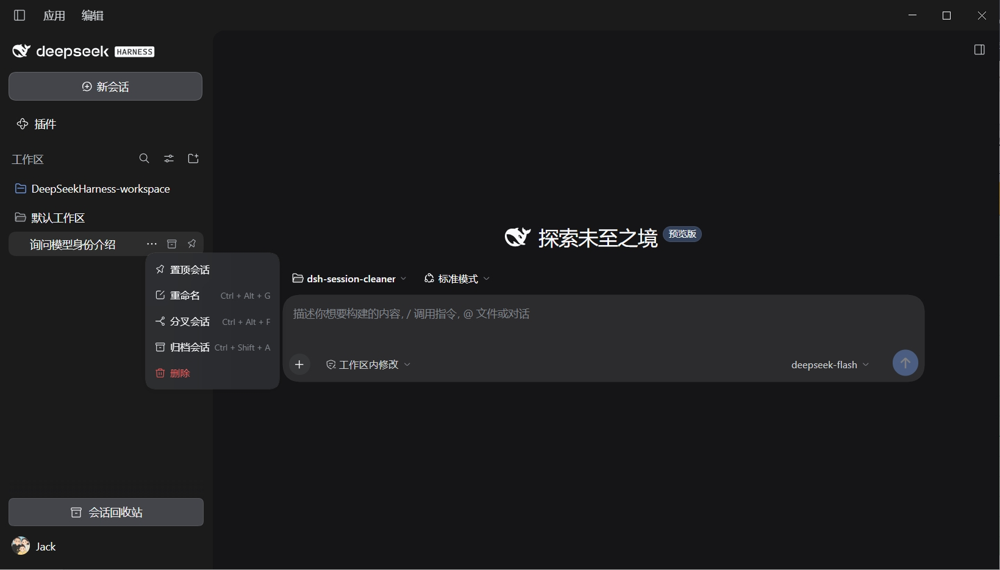
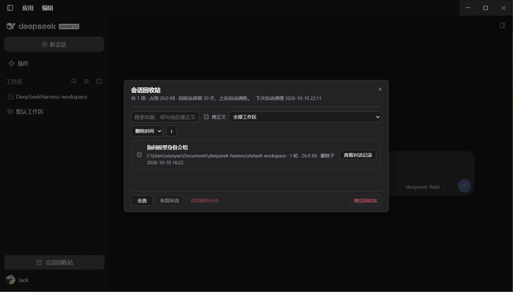
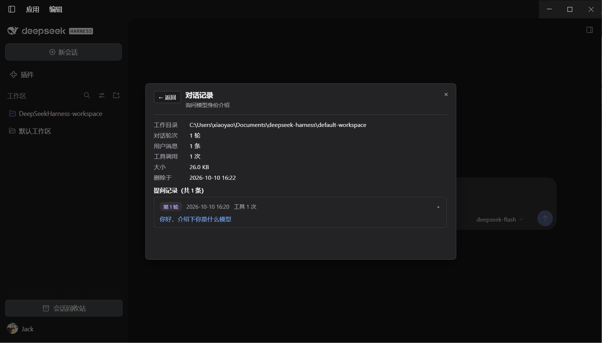

# dsh-session-cleaner

**[简体中文](README.md) | English**

A DSH (DeepSeek Harness) desktop plugin that puts a **"DSH Session Cleaner"** into the app: every session's `···` menu gets a red **Delete** item (currently before "Archive") that moves the session into a recycle bin, and the sidebar footer gets a **Session Recycle Bin** entry with search, restore and permanent deletion.

Version 0.8.0 is safety-first: it handles only **cold sessions**. A live Agent, a Session that has not shut down cleanly, SQLite, or a custom storage root is refused explicitly instead of being half-disposed or falsely reported as deleted. For a supported cold session, deletion cleans the workspace accounting slot, pin, archive flag and projection-cache row (including `.bak` copies), together with its cold subagent tree. Restore puts those back, including the original sidebar position. Active schedules are paused on delete and re-enabled on restore; only permanent delete removes them.

## Screenshots



A red **Delete** appears in the session `···` menu (currently before "Archive").



The **session recycle bin**: title/full-text search, workspace filter, sorting, restore and permanent delete.



**View chat log**: per-turn questions and assistant replies, rendered as Markdown, with long replies elided in the middle.

These images are declared by `screenshots.json` in the repository root (plugin marketplaces use it for their detail pages); the paths are relative to that file and point at images inside this repository.

## Download

Grab the latest archive from the [Releases page](https://github.com/jackxiao17/dsh-session-cleaner/releases/latest) and unpack it to get a `dsh-session-cleaner/` folder; `git clone` works too.

## Install

1. Copy the whole `dsh-session-cleaner/` folder into `~/.dsh/profiles/desktop/local/` (on Windows: `C:\Users\you\.dsh\profiles\desktop\local\dsh-session-cleaner\`)
2. Edit `~/.dsh/profiles/desktop/package.json`:
   - add `"dsh-session-cleaner": "file:./local/dsh-session-cleaner"` to `dependencies`
   - add `"dsh-session-cleaner"` to the `dsh.profile.bundles` array
3. Run DSH's bundled pnpm once in that directory:
   ```
   node "%DSH_HOME%\dsh-runtimes\dsh-primary-runtime\dependencies\pnpm\bin\pnpm.cjs" install -C %DSH_HOME%\profiles\desktop
   ```
4. Restart DSH; the plugin shows up on DSH's plugin management page

## Compatibility

- **0.8.0 requires DeepSeek Harness `>=0.2.3-alpha.2 <0.3.0`**. The current real-machine verified version is `0.2.3-alpha.2`; this release fixes live lifecycle handling, reversible schedules, storage-backend detection and sidebar button layout.
- **Supported:** cold sessions on the default JSONL Session backend and default sessions root; projection caches use the default JSON storage layout. Cold subagent trees are handled together.
- **Fail-closed:** a live Agent, a Session that has not shut down cleanly, or an active background job returns `409`; SQLite, an unknown Session backend, or a custom sessions root is refused too.
- **Node.js:** `^24.22.3 || >=26.13.1`, matching DSH `0.2.3-alpha.2`.
- **Verification status:** automated commands are listed below; real-machine platforms, coverage and results are recorded in the corresponding release notes.
- **DSH `0.2.2` and earlier are not supported; `0.3.0` and later are not declared yet.** After a major DSH upgrade, upgrade the plugin first if the menu disappears or an action reports an error; recycle-bin data remains under `~/.dsh/dsh-session-cleaner/trash/`.

## Usage

1. Session `···` → **Delete**: a cold session moves straight into the recycle bin, with a “✓ session moved to the recycle bin” toast.
2. Live sessions are refused safely: if a live Agent or a Session that has not shut down cleanly is still present, the plugin returns `409` with the reason instead of cancelling half a turn and moving the log anyway.
3. **Session recycle bin** (sidebar footer button):
   - Search: the title filters live; tick "search body" to match your questions and the assistant's replies
   - Workspace filter, sorting by deletion time / title / size / turns (both directions)
   - Select items, then **Restore selected / Delete selected forever** (with confirmation), or empty the whole bin
4. **View chat log**: each session's “view chat log” opens the per-turn questions with the assistant's replies (Markdown rendered, long replies elided in the middle, body keywords still searchable).
5. Restore: the directory moves back, the workspace accounting is re-attached **at its original slot**, the projection-cache row and pin/archive state come back, and schedules paused at delete time are re-enabled.
6. The bin keeps items for **30 days**: it is purged once at startup and then every **6 hours**; the panel shows the next purge time.

## What each step touches

| Where | Delete (to bin) | Restore | Permanent delete |
|---|---|---|---|
| `<dshHome>/sessions/<proj>/<id>/` | renamed into the bin (same-volume, atomic, never copied) | moved back | removed |
| Workspace accounting slot in `workspace.json` → the workspace's `sessionIds` | detached (the following session is recorded as an anchor) | re-attached **at its original position** | — |
| Global archive set `archivedSessionIds` | removed (whether it was archived is recorded) | restored as it was | — |
| Global pin set `pinnedSessionIds` | removed (its rank is recorded) | restored at its rank | — |
| Projection-cache row `storages/session_projcache/sessions/<id>.json` | removed through the host storage domain, snapshot kept verbatim | written back (file + host memory table) | re-checked, plus `<id>.json.bak.*` |
| Schedules bound to the session (`schedule` domain) | active tasks paused, history retained | tasks that were active at delete time are re-enabled | removed (active, paused and ended rows) |
| Its subagents (`origin: subagent` + `parentSession` pointing at it) | moved into the bin item's `.children/`, each with its own snapshot | restored with it (directory / slot / cache row / pin / archive) | removed with it (cache row + schedules + emptied project dir) |
| `<dshHome>/sessions/<proj>/` project directory | — | recreated when needed | removed once empty |

## Known limits

- DSH's plugin interfaces carry no official stability promise. When a host contract is unsupported, 0.8.0 fails closed instead of degrading and continuing to delete.
- The bin occupies disk space (the panel shows the total) and is capped by the 30-day retention.
- **Cold sessions only:** a live Agent, a Session that has not shut down cleanly, an active background job, an active terminal, or an active subagent tree returns `409`. This avoids bypassing the host's complete lifecycle and losing closing events.
- **Default JSONL + default sessions root only:** SQLite, an unknown backend or a custom sessions root returns `409` instead of creating a “successful” bin entry while the real log stays untouched. Custom storage routes are outside the supported scope.
- **Schedule reversibility:** active tasks are paused on delete and restored on restore. A one-shot task whose execution time has already passed may not recover its original timing semantics; the UI reports that explicitly. Permanent delete removes tasks for good.
- **Restore is not guaranteed to be byte-identical:** archived sessions still return to the archive; if the original anchor was deleted, the session returns to the top of the sidebar and the result says so.
- **Two log directories for the same id are refused:** paths are listed so one copy is not deleted while another survives behind a success result.
- **Crash safety:** the snapshot is written before the move; startup reconciles both halves and rolls incomplete moves back all-or-nothing. If a restore brought files home before metadata finished, startup resumes cache, workspace, pin/archive and schedule restoration from the snapshot instead of discarding it.
- **0.7.0 removed two HTTP endpoints nobody called:** `POST /delete` and `POST /status`. Deletion now has one path: move to the bin → delete forever.
- The implementation uses cross-platform `node:fs` / `node:path` APIs; real-machine platforms and results are recorded in the release notes.

## Uninstall / rollback

1. Remove the `dsh-session-cleaner` line from `dependencies` and from `dsh.profile.bundles` in `~/.dsh/profiles/desktop/package.json`
2. Run `pnpm install` in that directory (using DSH's bundled one: `node "%DSH_HOME%\dsh-runtimes\dsh-primary-runtime\dependencies\pnpm\bin\pnpm.cjs" install -C %DSH_HOME%\profiles\desktop`)
3. Restart DSH. The local folder `~/.dsh/profiles/desktop/local/dsh-session-cleaner\` can be deleted entirely

Note: anything still in the recycle bin stays under `~/.dsh/dsh-session-cleaner/trash/` after uninstalling; with the plugin gone DSH no longer lists those sessions, so move them back by hand (`trash/items/<id>/` → `sessions/<proj>/<id>/`) if you need them.

## Development and syncing (when you iterate on the source)

This repository is the plugin's source. After changing code, DSH does **not** load the new version by itself: you must copy the whole plugin folder over **both** of these, then restart DSH:

1. `~/.dsh/profiles/desktop/local/dsh-session-cleaner\` (the install source; on Windows under `C:\Users\you\.dsh\profiles\desktop\local\`)
2. `~/.dsh/profiles/desktop/node_modules/dsh-session-cleaner\` (the directory DSH actually loads)

Key points:

- **Pure code changes need no `pnpm install`** — overwrite the files and restart DSH. Only the first install, or a change to `package.json` dependencies, needs another run: `node "%DSH_HOME%\dsh-runtimes\dsh-primary-runtime\dependencies\pnpm\bin\pnpm.cjs" install -C %DSH_HOME%\profiles\desktop`
- **Why both copies**: the same-named files in those two directories are hard links (one copy of the data on disk), but a copy method that deletes the old file first (what many tools' "safe save" does) breaks the link, leaving `local` new and `node_modules` old — DSH then keeps loading the old code. Overwriting both avoids this.
- **Bump the version in both places while iterating**: `version` in `package.json` and `buildId` in `lib/index.js`. The plugin logs `dsh-session-cleaner v<version>` at startup, so one look at the log after a restart tells you whether the new version really took effect (in 2026-10 a bumped `package.json` with a forgotten `buildId` left the log showing the old number — always change both).
- Once the change is verified, commit and push to this repository so GitHub matches what you run locally; keep the tag, the Release and the version inside the zip aligned too.

### One-command release script

`scripts/release.ps1` is a maintainer tool (it does not take part in the plugin's runtime and is not packed into the release). `package.json`'s `files` includes `lib`, `cordis.patch.yml`, `icon.svg`, `locale`, `assets`, `screenshots.json` and both READMEs. It does these steps in order:

1. Verify that `package.json#version` and `lib/index.js#buildId` agree (it aborts otherwise, to prevent the "log shows the old version" problem again)
2. Build `dsh-session-cleaner-<version>.zip` and print its SHA256
3. Overwrite both directories under `~/.dsh/profiles/desktop/` (`local\` and `node_modules\`)
4. `git commit` → tag `v<version>` → push `main` and the tag
5. Update the repository About (from `package.json#about`, falling back to `description`; aborts if it exceeds GitHub's 350-character limit)
6. Create the Release (title always `dsh-session-cleaner v<version>`) and upload the zip

```powershell
# Dry run first: only prints what it would do, changes nothing
pwsh -NoProfile -File scripts/release.ps1 -DryRun

# Real release
pwsh -NoProfile -File scripts/release.ps1
```

Flags: `-SkipGit`, `-SkipSync`, `-SkipAbout`, `-SkipRelease` skip individual steps; `-Proxy ''` disables the proxy (default `http://127.0.0.1:7890`); `-Token` or the `GH_TOKEN` environment variable supplies a token — otherwise the script tries the `git:https://github.com` credential in Windows Credential Manager (kept in a process environment variable only: never printed, never in shell history). If no token is found it skips the Release and prints the manual upload hint.

### Run the verification harness before releasing

From the repository root:

```powershell
npm test
```

Or run the two maintainer scripts separately (they do not take part in the runtime and are not packed into the release):

```powershell
node scripts/verify.mjs
node scripts/verify-safety.mjs
node scripts/verify-client-layout.mjs
node scripts/verify-client-behavior.mjs
```

`verify.mjs` covers the core delete/restore/cache/locking/reconciliation/retention paths and Client registrations. `verify-safety.mjs` covers live-session refusal, backend detection, schedule pause/restore, interrupted-restore recovery and event contracts. `verify-client-layout.mjs` locks the sidebar footer layout. `verify-client-behavior.mjs` locks per-item failure feedback for permanent delete and empty-bin operations. Release only after all four pass.

## Changelog

### 0.8.0 (DSH 0.2.3-alpha.2 + safety-first)

- **Fixed the interrupted-restore crash window:** when files are home but metadata restoration did not finish, startup reconciliation resumes cache, workspace, pin/archive and schedule restoration from the snapshot. Partial child restores are retryable, family slots restore child-before-parent, incomplete metadata keeps the snapshot, and duplicate home/bin copies are refused instead of overwritten.
- **Permanent delete no longer reports false success:** the Client checks every `deleted` result and reports the exact failed items if any delete or empty-bin operation is only partially complete.
- **Restored the full button width:** the recycle-bin slot now fills the remaining space in the host footer Flex row instead of shrinking to its label, while the theme toggle keeps its own seat.
- **Kept the 36px rail footprint:** the collapsed sidebar still uses a fixed 36px icon slot and does not stretch with the wide layout.
- **Added layout and behavior regressions:** `npm test` now runs core, safety, Client layout and permanent-delete feedback suites.

- **Cold sessions only:** a live Agent, a Session that has not shut down cleanly, or an active subagent tree returns `409`; `scope.dispose + store.delete` is no longer used to bypass the host lifecycle.
- **Fail-closed storage backends:** only the default JSONL backend and default storage root are supported; SQLite, unknown backends and custom roots are refused instead of producing false success.
- **Reversible schedules:** active tasks are paused on delete and re-enabled on restore; only permanent delete removes them.
- **Stronger events and validation:** cold sessions no longer emit a fabricated `session/disposed`; v4 headers, subagent `origin`, path identity and depth checks are tightened.
- **Menu and docs aligned:** Delete currently appears before Archive; the Node requirement is now `^24.22.3 || >=26.13.1`; the minimum supported DSH version is tightened to `>=0.2.3-alpha.2 <0.3.0`, and DSH 0.2.2 or earlier is no longer declared compatible.
- **Verification upgraded:** `scripts/verify-safety.mjs`, `scripts/verify-client-layout.mjs` and `scripts/verify-client-behavior.mjs` add safety, Client layout and batch-delete feedback regressions; `npm test` runs all four.
- **Real-machine verification passed:** Windows Desktop + DSH `0.2.3-alpha.2`; a dedicated JSONL v4/zstd cold session completed delete → restore → delete again → permanent delete, log and cache hashes matched byte-for-byte, a live session was safely refused with `409` and no side effects, and all test data was removed.

### 0.7.9 (DSH 0.2.2-rc.5 adaptation + three data-safety fixes)

- **Compatibility re-checked against DeepSeek Harness `0.2.2-rc.5`** (full source audit plus live probes: `/session-cleaner/api/health` and `/trash/list` both return 200): between `0.2.2-rc.2` and `0.2.2-rc.5` only the `v0.2.2-rc.3` / `v0.2.2-rc.4` upgrade guides exist and neither touches session lifecycle or storage; every Host service, client slot, log format v4, projection-cache domain, `schedule` and `webServer` contract is aligned — nothing incompatible
- **Fixed a "delete that never finished" being purged as a committed entry** (the most serious one): on Windows `rename` can hit EBUSY, leaving an entry whose snapshot was written but whose files never moved into the bin (`stage=prepared`). Such an entry was previously treated by retention cleanup and "Empty Recycle Bin" as a deleted session, wiping the projection-cache row and every schedule of a session that still lived at home. Prepared entries now stay out of the listing and out of auto-cleanup, and a permanent delete applies the same adjudication startup reconciliation uses: roll back what can be rolled back, drop the snapshot, and only purge once everything is in the bin
- **Bounded retry on all four rename points** for the transient codes Windows throws (EBUSY / EPERM / ENOTEMPTY / EACCES, up to 8 attempts, 50ms exponential backoff capped at 2s) — which removes the main trigger behind the item above
- **Scheduled tasks that are still running are stopped when a session enters the bin**: its log is about to leave its slot, so due tasks would only fail one by one (the host records a warn, retries nothing, deletes no row). History rows stay untouched until permanent delete, which still clears them. Task creation cannot reproduce one verbatim, so this step is irreversible — but it follows the exact path the host's own archive uses
- **`readMeta` tolerates truncated or corrupt snapshots**: a damaged meta now yields the same 404 session-not-found as "no such entry" instead of a bare 500; the detail and restore endpoints no longer leak a raw SyntaxError to callers
- The verification harness adds prepared-misdelete, interrupted-restore residue and corrupt-snapshot cases: **248 passed / 0 failed**

### 0.7.8 (DSH 0.2.2-rc.2 adaptation + macOS overlay drag regions)

- **Compatibility re-checked against DeepSeek Harness `0.2.2-rc.2`** (source audit plus live probes: `/session-cleaner/api/health` and `/trash/list` both return 200): all 19 `rc.1 → rc.2` upgrade items were reviewed, and only `window-drag-regions` affected this plugin
- **Fixed the recycle-bin overlay dragging the window on macOS** (`0.2.2-rc.2`'s `window-drag-regions`): Electron app-regions are geometry-based, so an overlay that covers `data-window-drag` rows must declare its own exclusion. All three full-screen layers (bin list, chat detail, confirm dialog) now carry `data-window-drag-exclude`, so the top strip no longer falls through to the sidebar's drag region
- **The `session/disposed` fallback now passes the real Session**: the host signature is `(session: Session)` and the projection cache keys by object identity; when a live handle exists it is emitted, and only a cold session falls back to the id-only shape
- **Artifact scan covers the older formats**: `ARTIFACT_NAMES` now includes `session.v1.jsonl(.zstd)` and the plaintext variants of v2–v4, so profiles with `compression: 'none'` and leftover v1 directories are recognized too
- **macOS glass fills now use host tokens**: `--dsw-specific-sidebar-glass-fill` / `hover` / `collapsed-*`, so light, dark and the collapsed rail all follow the theme instead of four hard-coded hex values
- `package.json` gained `engines.dsh: ">=0.2.2-rc.2 <0.3.0"`, so the host's plugin compatibility check can flag a mismatch instead of loading silently
- The verification harness now asserts the overlay drag attributes and the legacy artifact names: **226 passed / 0 failed**

### 0.7.7 (plugin page shows a short intro again, not the whole README)

- **Fixed the plugin page rendering the full README as its detail document**: the host resolves a bundle's detail in the order "`meta.detail` in `locale/<language>.json` → the package README → the repo README (market entries only)". With no `meta.detail`, the page fell back to the package README and showed the install section and changelog.
- Added `locale/detail.zh.md` / `locale/detail.en.md` and pointed `meta.detail` at them in both locale files; the page now shows a short intro plus a link to the full GitHub documentation, while the README stays in the repo and the release zip.
- Packaging now carries `locale/*.md`: `files` switched to the whole `locale` directory and `exports` gained `./locale/*.md`.

### 0.7.6 (DSH 0.2.2-rc.1 adaptation + schedule ownership fix)

- **Compatibility re-checked against DeepSeek Harness `0.2.2-rc.1`** (full source audit plus live probes: `/session-cleaner/api/health` and `/trash/list` both return 200): the `workspaceRegistry` / `sessions` / `agents` / `storageDomain` / `webServer` services, the projection-cache domain, session log format v4, and the client slots plus `__ModuleLoader__` — nothing incompatible
- **Fixed the `0.2.2-rc.1` regression where "delete forever" no longer cleared scheduled tasks**: the host moved a task's session binding from the top-level `sessionId` to `target.sessionId` (the old field is kept only for legacy rows), so the previous filter matched nothing and the bin showed no schedules for the session; both shapes are now recognized
- **Followed the host's single-row delete change**: `0.2.2-rc.1` removed `schedule.delete({sessionId,id})` in favor of `edit({id, action:"delete"})`, and `list()` no longer filters by `sessionId` (pagination only). The plugin prefers `edit`, filters the page itself, and still falls back to `schedule.delete` on older hosts
- The verification harness now models the `0.2.2-rc.1` task shape (`target.sessionId` plus one legacy row) and adds a legacy-host fallback case: **214 passed / 0 failed**

### 0.7.5 (macOS layering restored for the sidebar button)

- **Fixed the sidebar "Session Recycle Bin" button looking more opaque than the native New Session button on macOS**: 0.7.4 moved the button onto product tokens, which already matched the light/dark fill, but the host additionally layers a translucent overlay on New Session under macOS (light `#ffffff8c`, hover `#ffffff4d`; dark `#ffffff26`, hover `#ffffff33`, all scoped to `[data-platform=darwin]`). That layer does not live in the tokens, so without it the button rendered as opaque white and looked noticeably brighter than the native one against the sidebar gradient. 0.7.5 restores those four rules in the host's own order
- The collapsed (rail) state now overrides border color only (`border-color:transparent`, keeping the base `.5px` width), matching the host's `.kB3qhq_collapsed` rule — so even the quirk where macOS dark + collapsed keeps a 15% white fill now matches the native button exactly
- **Zero impact on Windows / Linux**: every added rule is scoped to `[data-platform=darwin]`, the same check the host itself uses (`document.documentElement.dataset.platform === "darwin"`), so nothing matches off macOS; verified identical to 0.7.4 in both light and dark Windows themes

### 0.7.4 (sidebar button aligned with New Session + rc.5 re-check)

- **The sidebar "Session Recycle Bin" button now follows the product's New Session button**: the hard-coded light/dark colors are gone in favor of product tokens (`--dsw-alias-button-elevated-fill`, `--dsw-alias-border-l3`, `--dsw-alias-label-primary`, `--dsw-alias-interactive-bg-hover`), and its metrics match (`.5px` hairline, `radius-md` 12px, 38px height, `floating-hover` on hover) — default and hover states track the native button under any theme (including the dsh-ocean-theme shallow/deep variants)
- Compatibility re-checked against DeepSeek Harness **0.2.1-rc.5** (full source audit plus live probes: `/session-cleaner/api/health` and `/trash/list` both return 200): nothing incompatible
- Cleanup: dropped the `@deepseek-ai/dsh-client-ui-slots` entry from `dsh.client.inject` (that package no longer exists on rc.5), removed the now-dead `scl-themeLight` / `scl-themeDark` class names, and aligned `buildId` with 0.7.4

### 0.7.3 (0.2.1-rc.3 adaptation + dead-call cleanup)

- Compatibility audited against DeepSeek Harness **0.2.1-rc.3** source (host services, session log format v4, the projection-cache domain, client slots and `__ModuleLoader__`): nothing incompatible, and the plugin was exercised live on that build
- **Removed two client calls that no longer exist on rc.3**: the rc.3 session-list snapshot has no `current` field, the `sessions` service has no `clear()`, and the `workspaces` service has no `refresh()` — all three were best-effort calls for clearing the main view after a delete and refreshing the sidebar, silently skipped on rc.3. Clearing the main view of a deleted session is left entirely to the host's `session/disposed → api-session/removed` push; the post-restore sidebar refresh still uses `sessions.refresh()` (present on rc.3). The client-side `inject` drops `workspaces` accordingly

### 0.7.2 (plugin-page icon & localization + two fixes)

- **The plugin page now has its own icon, title and description**: added `icon.svg` plus `meta.title` / `meta.description` in `locale/zh.json` and `locale/en.json`, so DSH shows "会话清理 / Session Cleaner" in the current UI language; the release script also packs the icon and locale files into the zip, so people who download the release artifact see them too
- **Fixed a bloated recycle-bin list response**: `/trash/list` used to include each session's verbatim projection-cache row (`projcacheRow`, potentially large), contradicting the "display fields only" intent; the list no longer carries it (restore / permanent delete still read it from the meta file)
- **Fixed a half-broken state on reconciliation rollback**: if the process crashed right after moving the parent but before moving its children, the rollback only renamed the directory back, losing the projection-cache row, sidebar accounting and pin/archive flags; the rollback now reuses the restore path and brings those back too
- Added an assertion that locks the "list carries no projection-cache row" behavior (208 total)

### 0.7.1 (subagent cascade + alignment with 0.2.1)

- **A session's subagents are handled with it**: the host cascades agent disposal only, so a child session's log directory, accounting and projection-cache row used to survive the parent. Descendants are now discovered the way the host decides parentage (`origin: 'subagent'` + `parentSession`), and the whole tree moves to the bin, back, and out for good together; child directories live under the parent item's `.children/`, and startup reconciliation rolls back a half-moved tree all-or-nothing
- **Fixed an encoding mismatch**: the session directory name now mirrors the host's `encodeSegment()` (safe code units literal, everything else `~XXXX`); it previously mirrored the project-level `projectKey()` (`--…--` form). Host-minted ids are all safe characters so there was no practical impact, but an id needing escaping would not have been found
- **Removed two host-detached code paths**: `persistence.resolveLog` no longer exists in current builds, and `locate({id})` needs the stored header's `cwd` to name the project segment (an id alone resolves to `_no-cwd`). Directory discovery now follows the host's own path computation instead
- **Dropped a peerDependency pointing at the wrong package**: it declared the unscoped `cordis` (an unrelated third-party package) while DSH ships `@deepseek-ai/cordis`, and the plugin imports neither. Leaving it in could pull an extra package into someone's install
- Compatibility audited against DeepSeek Harness **0.2.1-rc.2** end to end (log format v4, zstd frame layout, projection-cache domain v7, workspaceRegistry / schedule / storageDomain / webServer contracts, client slots and `__ModuleLoader__`): nothing incompatible, and the whole delete → restore → permanent-delete cycle was exercised live on that build (subagent cascade included, plus a residue scan)
- The verification harness grew to **207 assertions**, adding the subagent cascade, half-move crash rollback, encoder alignment and the three projection-cache deletion paths

### 0.7.0 (deep cleaning)

- **The projection-cache row is really deleted now**: previously only the uncalled `/delete` endpoint removed it and every path reachable from the UI skipped it; it is now removed through the host storage domain when a session is moved to the bin, along with the host's `<id>.json.bak.*` backups
- **A pin no longer becomes a dangling reference**: `pinnedSessionIds` is cleared on delete and restored at its original rank
- **Restore returns the session to its original sidebar position**: the following session is recorded as an anchor and `insertSessionBefore` puts it back (`attachSession` only ever prepends)
- **Restore brings back the archive flag**: a session that was archived returns to the archive, and the toast says so
- **Permanent delete clears the schedules bound to the session** (active plus already-ended rows) and removes the emptied project directory
- **Retention went from "startup only" to "startup + every 6 hours"**, and the panel shows the next purge time
- **Crash safety and startup reconciliation**: the snapshot is written before the move; startup reconciles both halves — rolled-back phantom entries, adopted orphan directories, cleaned-up temporary files
- **Two log directories for one id are refused** with the paths listed, instead of deleting one and reporting success
- **Locking is unified per session id**: restore and permanent delete can no longer interleave; batch operations take the batch slot first and each session slot afterwards
- Removed the two uncalled endpoints `POST /delete` and `POST /status`
- Fixed the stale source header comment claiming running sessions are always refused (the real behaviour is: the current turn is ended, then the session is deleted)

## License

[MIT](LICENSE)

