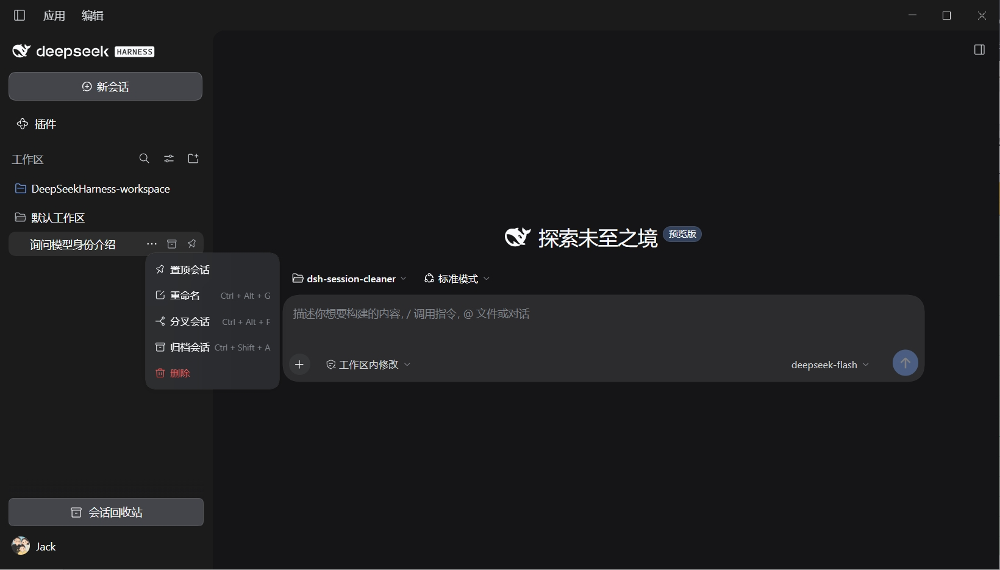
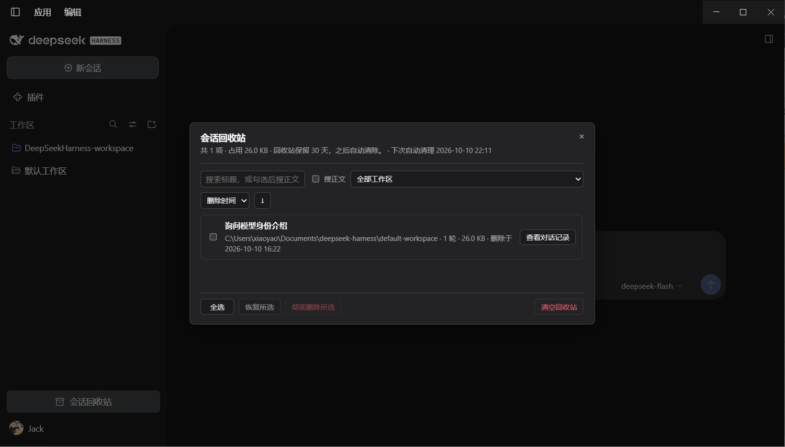
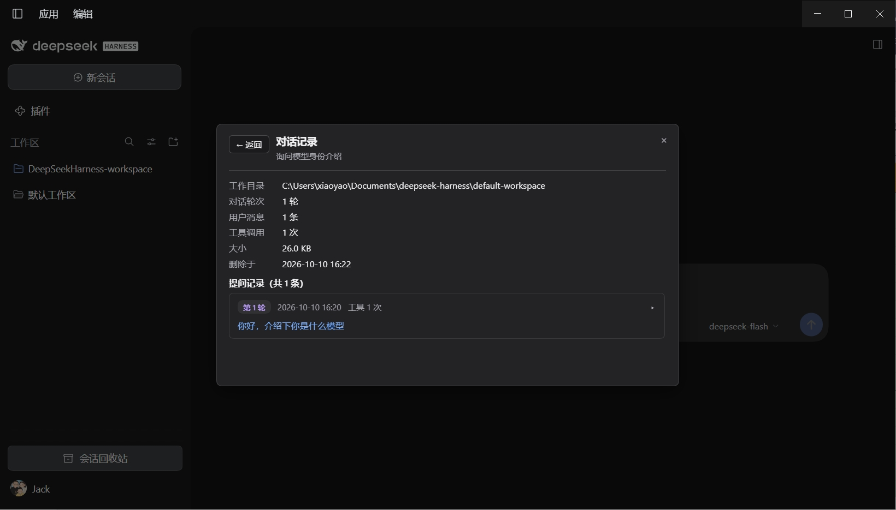

# dsh-session-cleaner

**[简体中文](README.md) | English**

A DSH (DeepSeek Harness) desktop plugin that puts a **"DSH Session Cleaner"** into the app: every session's `···` menu gets a red **Delete** item (below "Archive") that moves the session into a recycle bin, and the sidebar footer gets a **Session Recycle Bin** entry with search, restore and permanent deletion.

Deleting a session is not just moving its log directory: every trace it left in DSH is handled too — the workspace accounting slot, its pin, its archive flag, and the projection-cache row (including the host's `.bak` copies). **A session with subagents moves as a whole tree**: the host cascades agent disposal only, so a child session's log directory, accounting and cache row would otherwise survive the parent. Restoring puts each of those back, **including the session's original position in the sidebar**. Permanently deleting a binned session also clears the schedules bound to it and removes its project directory once it is empty.

## Screenshots



A red **Delete** appears in the session `···` menu (below "Archive").



The **session recycle bin**: title/full-text search, workspace filter, sorting, restore and permanent delete.



**View chat log**: per-turn questions and assistant replies, rendered as Markdown, with long replies elided in the middle.

These images are declared by `screenshots.json` in the repository root (plugin marketplaces use it for their detail pages); the paths are relative to that file and point at images inside this repository.

## Download

Grab the latest archive from the [Releases page](https://github.com/jackxiao17/dsh-session-cleaner/releases/latest) and unpack it to get a `dsh-session-cleaner/` folder; `git clone` works too.

## Install

1. Copy the whole `dsh-session-cleaner/` folder into `~/.dsh/profiles/desktop/local/` (on Windows: `C:\Users\you\.dsh\profiles\desktop\local\dsh-session-cleaner\`)
2. Edit `~/.dsh/profiles/desktop/package.json`:
   - add `"dsh-session-cleaner": "file:./local/dsh-session-cleaner"` to `dependencies`
   - add `"dsh-session-cleaner"` to the `dsh.profile.bundles` array
3. Run DSH's bundled pnpm once in that directory:
   ```
   node "%DSH_HOME%\dsh-runtimes\dsh-primary-runtime\dependencies\pnpm\bin\pnpm.cjs" install -C %DSH_HOME%\profiles\desktop
   ```
4. Restart DSH; the plugin shows up on DSH's plugin management page

## Compatibility

- **Re-verified on DeepSeek Harness `0.2.2-rc.1`** (desktop build, the `dsh web` web profile): full source audit plus live probes (`/session-cleaner/api/health` and `/trash/list` both return 200); the earlier live pass (delete, restore, the recycle bin and the chat-log viewer) ran on `0.2.1-rc.3`, and the full regression (subagent cascade plus a whole-`~/.dsh` residue scan) on `0.2.1-rc.2`
- Every host contract it relies on was checked against the `0.2.2-rc.1` source: session log format v4 and its zstd frame layout, the `session_projcache` storage domain v7, the `workspaceRegistry` / `schedule` / `storageDomain` / `webServer` services, and the client slots plus `__ModuleLoader__` — nothing incompatible
- **Backward compatibility is not verified, so it is not promised.** What can be said is how it fails: every host API call is guarded by an existence check and falls back to the equivalent file-level path, so on an older build the worst case is **less functionality** (for example the slot cannot be restored, so the session returns to the top of the sidebar — reported honestly), never deleting the wrong thing or leaving invisible garbage
- `0.1.x` is untested: that line went through v0→v4 format migrations and large API changes, so it is not recommended
- If a major DSH upgrade breaks the plugin, the symptom is a missing menu item/button or an error on an action — session data is never harmed. Binned data stays under `~/.dsh/dsh-session-cleaner/trash/` and can be moved back by hand to `sessions/<proj>/<id>/`

## Usage

1. Session `···` → **Delete**: moves straight into the recycle bin, with a "✓ session moved to the recycle bin" toast (no confirm dialog — it is recoverable)
2. A session with a running turn can be deleted too: the current turn is ended first (turn cancelled, agent disposed), then the session is moved
3. **Session recycle bin** (sidebar footer button):
   - Search: the title filters live; tick "search body" to match your questions and the assistant's replies
   - Workspace filter, sorting by deletion time / title / size / turns (both directions)
   - Select items, then **Restore selected / Delete selected forever** (with confirmation), or empty the whole bin
4. **View chat log**: each session's "view chat log" opens the per-turn questions with the assistant's replies (Markdown rendered, long replies elided in the middle, body keywords still searchable)
5. Restore: the directory moves back, the workspace accounting is re-attached **at its original slot**, the projection-cache row is restored verbatim, and the pin and archive flag come back (a session that was archived returns to the archive — the toast says where it went)
6. The bin keeps items for **30 days**: it is purged once at startup and then every **6 hours** (so a long-running DSH does not skip it); the panel shows the next purge time

## What each step touches

| Where | Delete (to bin) | Restore | Permanent delete |
|---|---|---|---|
| `<dshHome>/sessions/<proj>/<id>/` | renamed into the bin (same-volume, atomic, never copied) | moved back | removed |
| Workspace accounting slot in `workspace.json` → the workspace's `sessionIds` | detached (the following session is recorded as an anchor) | re-attached **at its original position** | — |
| Global archive set `archivedSessionIds` | removed (whether it was archived is recorded) | restored as it was | — |
| Global pin set `pinnedSessionIds` | removed (its rank is recorded) | restored at its rank | — |
| Projection-cache row `storages/session_projcache/sessions/<id>.json` | removed through the host storage domain, snapshot kept verbatim | written back (file + host memory table) | re-checked, plus `<id>.json.bak.*` |
| Schedules bound to the session (`schedule` domain) | **left alone**: snapshotted for display | nothing to restore (never touched) | removed (active + already-ended rows) |
| Its subagents (`origin: subagent` + `parentSession` pointing at it) | moved into the bin item's `.children/`, each with its own snapshot | restored with it (directory / slot / cache row / pin / archive) | removed with it (cache row + schedules + emptied project dir) |
| `<dshHome>/sessions/<proj>/` project directory | — | recreated when needed | removed once empty |

## Known limits

- DSH's plugin interfaces carry no official stability promise; a major upgrade can break the plugin — the symptom is a missing menu item/button or an error on an action, never damage to session data
- The bin occupies disk space (the panel shows the total) and is capped by the 30-day retention
- **Schedules are not removed while a session sits in the bin**: for a reminder whose session is gone the host only logs a warning — it does not recreate the session and does not retry. Use "delete forever" to clear them. The reason for the split is that the host's `schedule` service **cannot recreate a task faithfully** (a new task gets a new id and an empty delivery history), so deleting at bin time would make a reversible step irreversible
- **Restore is not guaranteed to be byte-identical to the moment before deletion**: an archived session returns into the archive (it does not jump into the sidebar), and if its anchor session has been deleted it stays at the top of the sidebar (the panel reports "position not restored" honestly)
- **Two log directories for the same id are refused**: that is a corrupt layout the host itself refuses to resolve, so the plugin lists the paths for you to handle by hand instead of deleting one copy, leaving the other, and reporting success
- **Crash safety**: the snapshot is written before the files move and upgraded to its final state afterwards; startup runs a two-way reconciliation — a leftover "never moved" snapshot is rolled back (with subagents this is all-or-nothing: if any member is still at home, the ones already moved go back), and a bin directory without a snapshot is adopted as a "data incomplete" entry (visible and permanently deletable, but not restorable, because its original path is unknowable)
- **0.7.0 removed two HTTP endpoints nobody called**: `POST /delete` (physical delete without the bin) and `POST /status`. Deletion now has a single path: move to the bin → delete forever
- Verified on the local desktop build (the `dsh web` web profile) only; no other deployment shape was tested

## Uninstall / rollback

1. Remove the `dsh-session-cleaner` line from `dependencies` and from `dsh.profile.bundles` in `~/.dsh/profiles/desktop/package.json`
2. Run `pnpm install` in that directory (using DSH's bundled one: `node "%DSH_HOME%\dsh-runtimes\dsh-primary-runtime\dependencies\pnpm\bin\pnpm.cjs" install -C %DSH_HOME%\profiles\desktop`)
3. Restart DSH. The local folder `~/.dsh/profiles/desktop/local/dsh-session-cleaner\` can be deleted entirely

Note: anything still in the recycle bin stays under `~/.dsh/dsh-session-cleaner/trash/` after uninstalling; with the plugin gone DSH no longer lists those sessions, so move them back by hand (`trash/items/<id>/` → `sessions/<proj>/<id>/`) if you need them.

## Development and syncing (when you iterate on the source)

This repository is the plugin's source. After changing code, DSH does **not** load the new version by itself: you must copy the whole plugin folder over **both** of these, then restart DSH:

1. `~/.dsh/profiles/desktop/local/dsh-session-cleaner\` (the install source; on Windows under `C:\Users\you\.dsh\profiles\desktop\local\`)
2. `~/.dsh/profiles/desktop/node_modules/dsh-session-cleaner\` (the directory DSH actually loads)

Key points:

- **Pure code changes need no `pnpm install`** — overwrite the files and restart DSH. Only the first install, or a change to `package.json` dependencies, needs another run: `node "%DSH_HOME%\dsh-runtimes\dsh-primary-runtime\dependencies\pnpm\bin\pnpm.cjs" install -C %DSH_HOME%\profiles\desktop`
- **Why both copies**: the same-named files in those two directories are hard links (one copy of the data on disk), but a copy method that deletes the old file first (what many tools' "safe save" does) breaks the link, leaving `local` new and `node_modules` old — DSH then keeps loading the old code. Overwriting both avoids this.
- **Bump the version in both places while iterating**: `version` in `package.json` and `buildId` in `lib/index.js`. The plugin logs `dsh-session-cleaner v<version>` at startup, so one look at the log after a restart tells you whether the new version really took effect (in 2026-10 a bumped `package.json` with a forgotten `buildId` left the log showing the old number — always change both).
- Once the change is verified, commit and push to this repository so GitHub matches what you run locally; keep the tag, the Release and the version inside the zip aligned too.

### One-command release script

`scripts/release.ps1` is a maintainer tool (it does not take part in the plugin's runtime and is not packed into the release — `package.json`'s `files` lists `lib`, `cordis.patch.yml` and the READMEs). It does these steps in order:

1. Verify that `package.json#version` and `lib/index.js#buildId` agree (it aborts otherwise, to prevent the "log shows the old version" problem again)
2. Build `dsh-session-cleaner-<version>.zip` and print its SHA256
3. Overwrite both directories under `~/.dsh/profiles/desktop/` (`local\` and `node_modules\`)
4. `git commit` → tag `v<version>` → push `main` and the tag
5. Create the Release (title always `dsh-session-cleaner v<version>`) and upload the zip

```powershell
# Dry run first: only prints what it would do, changes nothing
pwsh -NoProfile -File scripts/release.ps1 -DryRun

# Real release
pwsh -NoProfile -File scripts/release.ps1
```

Flags: `-SkipGit`, `-SkipSync`, `-SkipRelease` skip individual steps; `-Proxy ''` disables the proxy (default `http://127.0.0.1:7890`); `-Token` or the `GH_TOKEN` environment variable supplies a token — otherwise the script tries the `git:https://github.com` credential in Windows Credential Manager (kept in a process environment variable only: never printed, never in shell history). If no token is found it skips the Release and prints the manual upload hint.

### Run the verification harness before releasing

`scripts/verify.mjs` is a maintainer tool (it does not take part in the runtime and is not packed into the release). Using a mock host plus real temporary directories, it actually exercises the key paths: path validation, move-to-bin, restore (slot / pin / archive / cache-row restoration), permanent delete (schedules and emptied directories), concurrency locking, duplicate-directory refusal, startup reconciliation, retention purging, real DSH log frame parsing, plus the client bundle's slot registrations and zh/en dictionary parity.

```powershell
node scripts\verify.mjs
```

Release only when it ends with `N 通过 / 0 失败` (N passed / 0 failed).

## Changelog

### 0.7.6 (DSH 0.2.2-rc.1 adaptation + schedule ownership fix)

- **Compatibility re-checked against DeepSeek Harness `0.2.2-rc.1`** (full source audit plus live probes: `/session-cleaner/api/health` and `/trash/list` both return 200): the `workspaceRegistry` / `sessions` / `agents` / `storageDomain` / `webServer` services, the projection-cache domain, session log format v4, and the client slots plus `__ModuleLoader__` — nothing incompatible
- **Fixed the `0.2.2-rc.1` regression where "delete forever" no longer cleared scheduled tasks**: the host moved a task's session binding from the top-level `sessionId` to `target.sessionId` (the old field is kept only for legacy rows), so the previous filter matched nothing and the bin showed no schedules for the session; both shapes are now recognized
- **Followed the host's single-row delete change**: `0.2.2-rc.1` removed `schedule.delete({sessionId,id})` in favor of `edit({id, action:"delete"})`, and `list()` no longer filters by `sessionId` (pagination only). The plugin prefers `edit`, filters the page itself, and still falls back to `schedule.delete` on older hosts
- The verification harness now models the `0.2.2-rc.1` task shape (`target.sessionId` plus one legacy row) and adds a legacy-host fallback case: **214 passed / 0 failed**

### 0.7.5 (macOS layering restored for the sidebar button)

- **Fixed the sidebar "Session Recycle Bin" button looking more opaque than the native New Session button on macOS**: 0.7.4 moved the button onto product tokens, which already matched the light/dark fill, but the host additionally layers a translucent overlay on New Session under macOS (light `#ffffff8c`, hover `#ffffff4d`; dark `#ffffff26`, hover `#ffffff33`, all scoped to `[data-platform=darwin]`). That layer does not live in the tokens, so without it the button rendered as opaque white and looked noticeably brighter than the native one against the sidebar gradient. 0.7.5 restores those four rules in the host's own order
- The collapsed (rail) state now overrides border color only (`border-color:transparent`, keeping the base `.5px` width), matching the host's `.kB3qhq_collapsed` rule — so even the quirk where macOS dark + collapsed keeps a 15% white fill now matches the native button exactly
- **Zero impact on Windows / Linux**: every added rule is scoped to `[data-platform=darwin]`, the same check the host itself uses (`document.documentElement.dataset.platform === "darwin"`), so nothing matches off macOS; verified identical to 0.7.4 in both light and dark Windows themes

### 0.7.4 (sidebar button aligned with New Session + rc.5 re-check)

- **The sidebar "Session Recycle Bin" button now follows the product's New Session button**: the hard-coded light/dark colors are gone in favor of product tokens (`--dsw-alias-button-elevated-fill`, `--dsw-alias-border-l3`, `--dsw-alias-label-primary`, `--dsw-alias-interactive-bg-hover`), and its metrics match (`.5px` hairline, `radius-md` 12px, 38px height, `floating-hover` on hover) — default and hover states track the native button under any theme (including the dsh-ocean-theme shallow/deep variants)
- Compatibility re-checked against DeepSeek Harness **0.2.1-rc.5** (full source audit plus live probes: `/session-cleaner/api/health` and `/trash/list` both return 200): nothing incompatible
- Cleanup: dropped the `@deepseek-ai/dsh-client-ui-slots` entry from `dsh.client.inject` (that package no longer exists on rc.5), removed the now-dead `scl-themeLight` / `scl-themeDark` class names, and aligned `buildId` with 0.7.4

### 0.7.3 (0.2.1-rc.3 adaptation + dead-call cleanup)

- Compatibility audited against DeepSeek Harness **0.2.1-rc.3** source (host services, session log format v4, the projection-cache domain, client slots and `__ModuleLoader__`): nothing incompatible, and the plugin was exercised live on that build
- **Removed two client calls that no longer exist on rc.3**: the rc.3 session-list snapshot has no `current` field, the `sessions` service has no `clear()`, and the `workspaces` service has no `refresh()` — all three were best-effort calls for clearing the main view after a delete and refreshing the sidebar, silently skipped on rc.3. Clearing the main view of a deleted session is left entirely to the host's `session/disposed → api-session/removed` push; the post-restore sidebar refresh still uses `sessions.refresh()` (present on rc.3). The client-side `inject` drops `workspaces` accordingly

### 0.7.2 (plugin-page icon & localization + two fixes)

- **The plugin page now has its own icon, title and description**: added `icon.svg` plus `meta.title` / `meta.description` in `locale/zh.json` and `locale/en.json`, so DSH shows "会话清理 / Session Cleaner" in the current UI language; the release script also packs the icon and locale files into the zip, so people who download the release artifact see them too
- **Fixed a bloated recycle-bin list response**: `/trash/list` used to include each session's verbatim projection-cache row (`projcacheRow`, potentially large), contradicting the "display fields only" intent; the list no longer carries it (restore / permanent delete still read it from the meta file)
- **Fixed a half-broken state on reconciliation rollback**: if the process crashed right after moving the parent but before moving its children, the rollback only renamed the directory back, losing the projection-cache row, sidebar accounting and pin/archive flags; the rollback now reuses the restore path and brings those back too
- Added an assertion that locks the "list carries no projection-cache row" behavior (208 total)

### 0.7.1 (subagent cascade + alignment with 0.2.1)

- **A session's subagents are handled with it**: the host cascades agent disposal only, so a child session's log directory, accounting and projection-cache row used to survive the parent. Descendants are now discovered the way the host decides parentage (`origin: 'subagent'` + `parentSession`), and the whole tree moves to the bin, back, and out for good together; child directories live under the parent item's `.children/`, and startup reconciliation rolls back a half-moved tree all-or-nothing
- **Fixed an encoding mismatch**: the session directory name now mirrors the host's `encodeSegment()` (safe code units literal, everything else `~XXXX`); it previously mirrored the project-level `projectKey()` (`--…--` form). Host-minted ids are all safe characters so there was no practical impact, but an id needing escaping would not have been found
- **Removed two host-detached code paths**: `persistence.resolveLog` no longer exists in current builds, and `locate({id})` needs the stored header's `cwd` to name the project segment (an id alone resolves to `_no-cwd`). Directory discovery now follows the host's own path computation instead
- **Dropped a peerDependency pointing at the wrong package**: it declared the unscoped `cordis` (an unrelated third-party package) while DSH ships `@deepseek-ai/cordis`, and the plugin imports neither. Leaving it in could pull an extra package into someone's install
- Compatibility audited against DeepSeek Harness **0.2.1-rc.2** end to end (log format v4, zstd frame layout, projection-cache domain v7, workspaceRegistry / schedule / storageDomain / webServer contracts, client slots and `__ModuleLoader__`): nothing incompatible, and the whole delete → restore → permanent-delete cycle was exercised live on that build (subagent cascade included, plus a residue scan)
- The verification harness grew to **207 assertions**, adding the subagent cascade, half-move crash rollback, encoder alignment and the three projection-cache deletion paths

### 0.7.0 (deep cleaning)

- **The projection-cache row is really deleted now**: previously only the uncalled `/delete` endpoint removed it and every path reachable from the UI skipped it; it is now removed through the host storage domain when a session is moved to the bin, along with the host's `<id>.json.bak.*` backups
- **A pin no longer becomes a dangling reference**: `pinnedSessionIds` is cleared on delete and restored at its original rank
- **Restore returns the session to its original sidebar position**: the following session is recorded as an anchor and `insertSessionBefore` puts it back (`attachSession` only ever prepends)
- **Restore brings back the archive flag**: a session that was archived returns to the archive, and the toast says so
- **Permanent delete clears the schedules bound to the session** (active plus already-ended rows) and removes the emptied project directory
- **Retention went from "startup only" to "startup + every 6 hours"**, and the panel shows the next purge time
- **Crash safety and startup reconciliation**: the snapshot is written before the move; startup reconciles both halves — rolled-back phantom entries, adopted orphan directories, cleaned-up temporary files
- **Two log directories for one id are refused** with the paths listed, instead of deleting one and reporting success
- **Locking is unified per session id**: restore and permanent delete can no longer interleave; batch operations take the batch slot first and each session slot afterwards
- Removed the two uncalled endpoints `POST /delete` and `POST /status`
- Fixed the stale source header comment claiming running sessions are always refused (the real behaviour is: the current turn is ended, then the session is deleted)

## License

[MIT](LICENSE)

