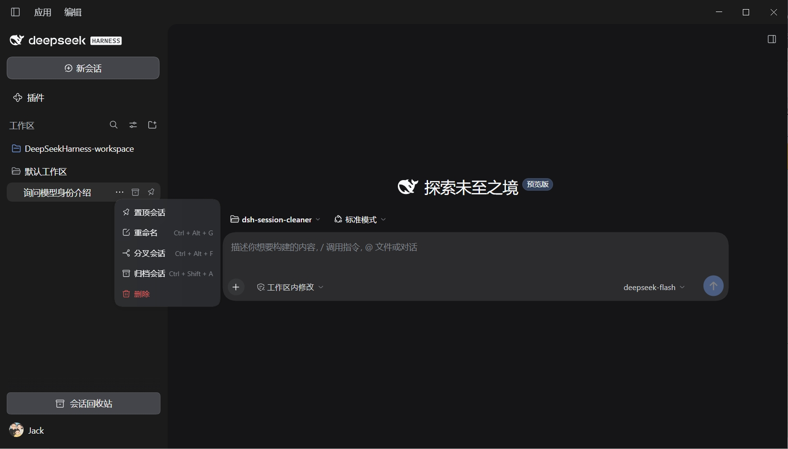
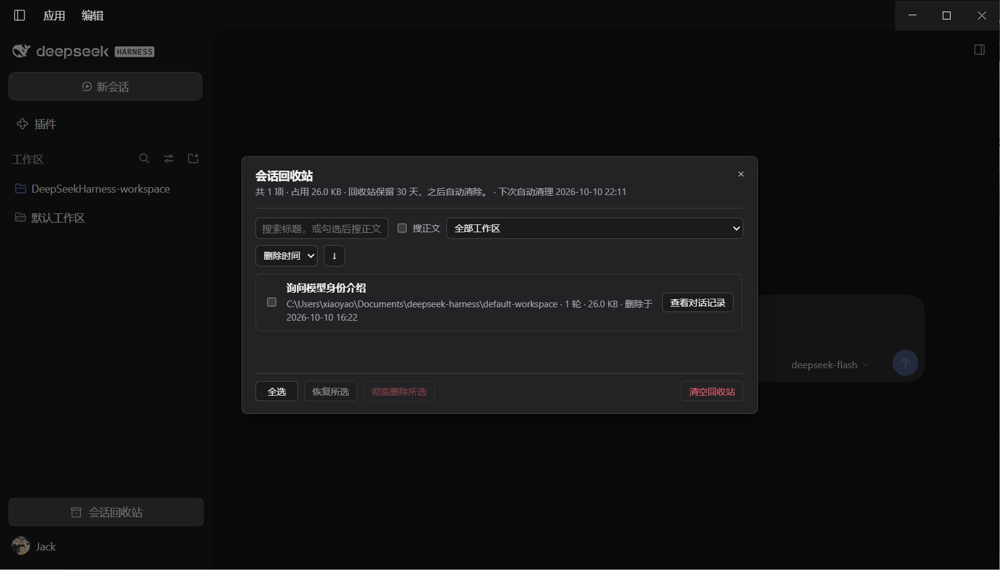
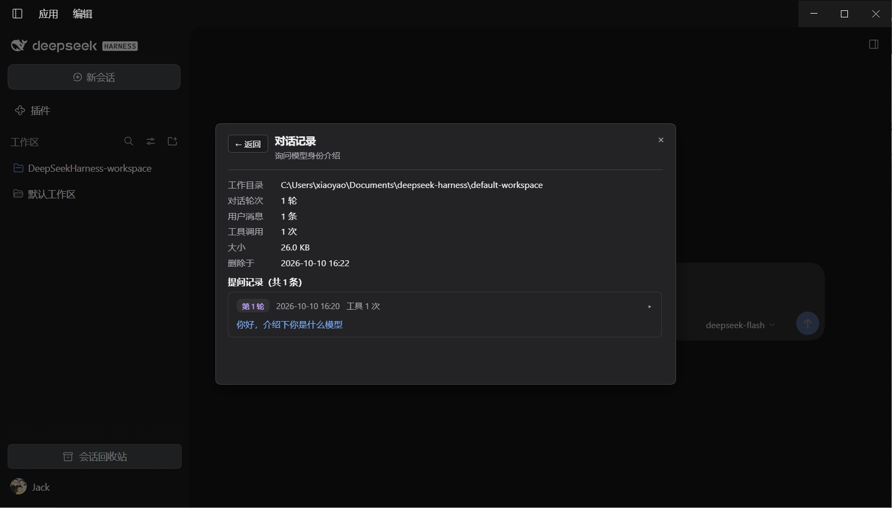

# dsh-session-cleaner

**简体中文 | [English](README.en.md)**

把「DSH 会话清理」装进 DSH 桌面版：侧栏每个会话的 `···` 菜单里多一项红色的**删除**（当前位于“归档”之前），一键移入回收站；侧栏底部有**会话回收站**入口，支持搜索、恢复与彻底删除。

0.8.0 采用安全优先策略：只处理已经退出的**冷会话**；检测到实时 Agent、未正常关闭的实时 Session、SQLite 后端或自定义存储根目录时会明确拒绝，不会做半拆除或报假成功。冷会话删除时会同步处理工作区记账槽位、置顶、归档标记、投影缓存行（含 `.bak` 备份）及其冷子代理树。恢复时逐项还原，包括侧栏原位置；活动定时任务先暂停，恢复时重新启用，只有彻底删除才会永久移除。

## 截图



会话 `···` 菜单里多出红色的**删除**（当前位于“归档”之前）。



**会话回收站**：标题/正文搜索、工作区筛选、排序、恢复与彻底删除。



**查看对话记录**：逐轮提问与助手回复，Markdown 渲染，超长回复中间省略。

以上图片由本仓库根目录的 `screenshots.json` 声明（插件市场详情页按它展示），路径相对该文件、指向仓库内的图片。

## 下载

到 [Releases 页面](https://github.com/jackxiao17/dsh-session-cleaner/releases/latest) 下载最新版压缩包并解压，得到 `dsh-session-cleaner/` 文件夹；也可以 `git clone` 本仓库。

## 安装

1. 把 `dsh-session-cleaner/` 整个文件夹拷到 `~/.dsh/profiles/desktop/local/` 下（Windows 即 `C:\Users\你\.dsh\profiles\desktop\local\dsh-session-cleaner\`）
2. 编辑 `~/.dsh/profiles/desktop/package.json`：
   - `dependencies` 里加一行：`"dsh-session-cleaner": "file:./local/dsh-session-cleaner"`
   - `dsh.profile.bundles` 数组里加一项：`"dsh-session-cleaner"`
3. 在该目录跑一次 DSH 自带的 pnpm：
   ```
   node "%DSH_HOME%\dsh-runtimes\dsh-primary-runtime\dependencies\pnpm\bin\pnpm.cjs" install -C %DSH_HOME%\profiles\desktop
   ```
4. 重启 DSH 生效；在 DSH 的插件管理页可见

## 兼容性

- **0.8.0 适配 DeepSeek Harness `0.2.3-alpha.2`**，重点修复实时生命周期、定时任务可恢复性、存储后端识别和侧栏按钮布局。
- **支持范围**：默认 JSONL Session 后端与默认 sessions root 下的冷会话；投影缓存按默认 JSON storage 布局处理。冷子代理树会一并处理。
- **安全拒绝**：存在 live Agent、未正常关闭的 live Session 或活动后台任务时返回 `409`；SQLite、未知 Session 后端或自定义 sessions root 同样拒绝操作。
- **Node.js**：`^24.22.3 || >=26.13.1`，与 DSH `0.2.3-alpha.2` 要求一致。
- **验证状态**：自动化测试命令见下文；真机验证平台、覆盖范围和结果以对应版本的发版记录为准。
- 更早的 DSH 版本未逐项验证，不做兼容承诺。升级大版本后若出现菜单消失或操作报错，请先升级插件；回收站数据仍保存在 `~/.dsh/dsh-session-cleaner/trash/`。

## 用法

1. 点会话 `···` → **删除**：冷会话直接移入回收站，顶部提示“✓ 会话已删除至回收站”。
2. 实时会话安全拒绝：如果会话仍有 live Agent 或未正常关闭的 live Session，插件返回 `409` 并说明原因，不会取消半轮回答后强行移动日志。
3. **会话回收站**（侧栏底部按钮）：
   - 搜索：标题实时过滤；勾选「搜正文」后按关键词搜提问与回复内容
   - 工作区筛选、按删除时间/标题/大小/轮次排序（可倒序）
   - 勾选后底部**恢复所选 / 彻底删除所选**（有确认），也可一键清空
4. **查看对话记录**：每条会话的“查看对话记录”打开逐轮提问与助手回复（Markdown 渲染，超长回复中间省略，正文关键词仍可搜到）。
5. 恢复：目录搬回原位、记账挂回原工作区**并回到原来的槽位**、投影缓存行还原、置顶与归档状态还原；删除时暂停的活动定时任务会重新启用。
6. 回收站保留 **30 天**：启动时清一次，之后每 **6 小时**清一次；面板会显示下次自动清理的时刻。

## 删除 / 恢复 / 彻底删除，各自动了什么

| 位置 | 移入回收站 | 恢复 | 彻底删除 |
|---|---|---|---|
| `<dshHome>/sessions/<项目段>/<会话id>/` | 整体 `rename` 到回收站（同盘瞬时，不复制） | 搬回原位 | 删除 |
| 工作区记账号位 `workspace.json` → 工作区的 `sessionIds` | 摘掉槽位（并记下后继会话作为锚点） | 挂回并**插回原位置** | — |
| 全局归档集合 `archivedSessionIds` | 摘掉（并记下删除前是否归档） | 按原状态还原 | — |
| 全局置顶集合 `pinnedSessionIds` | 摘掉（并记下原次序） | 按原次序还原 | — |
| 投影缓存行 `storages/session_projcache/sessions/<id>.json` | 通过宿主存储域删除，快照留原文 | 原文写回（文件 + 宿主内存表） | 复查并清掉（含 `<id>.json.bak.*`） |
| 绑定该会话的定时任务（`schedule` 域） | 活动任务暂停，历史任务保留 | 重新启用删除时处于活动状态的任务 | 清掉（活动、暂停及已结束的历史行） |
| 它的子会话（`origin: subagent` + `parentSession` 指向它） | 一并搬进回收站的 `.children/`，各自留快照 | 一并还原（目录/槽位/缓存行/置顶/归档） | 一并清掉（缓存行 + 定时任务 + 空工程目录） |
| `<dshHome>/sessions/<项目段>/` 工程目录 | — | 需要时重建 | 空了就删掉 |

## 已知边界

- DSH 的插件接口没有官方稳定性承诺；遇到不支持的宿主契约时，0.8.0 优先安全拒绝，而不是降级后继续删。
- 回收站会占磁盘空间（面板顶部显示总占用），靠 30 天保留期兜底。
- **只支持冷会话**：live Agent、未正常关闭的 live Session、活动后台任务、活动终端或活动子代理树都会触发 `409`。这是为了避免绕过宿主完整生命周期而丢失收尾事件。
- **只支持默认 JSONL + 默认 sessions root**：SQLite、未知后端或自定义 sessions root 会触发 `409`，不会产生“报成功但真实日志没动”的回收项。自定义 storage route 不在支持范围。
- **定时任务可逆性**：活动任务在 trash 时暂停、restore 时恢复；如果任务是一次性且已过执行时间，宿主可能无法恢复原执行语义，此时会明确提示。purge 才永久删除任务。
- **恢复不保证与删除前逐字节相同**：归档会话仍回到归档列表；原锚点会话已被删除时，恢复后停在侧栏顶部并如实回报。
- **同 id 有两份日志目录时拒绝操作**：插件会列出路径，避免删一份、留另一份却报成功。
- **崩溃安全**：快照先写、文件后搬；启动时双向对账，未搬完的条目按全有或全无回滚；恢复途中若文件已回家而元数据未写完，会从快照续恢复缓存、工作区、置顶/归档与定时任务，而不是直接丢快照。
- **0.7.0 移除了两个没人调用的 HTTP 端点**：`POST /delete` 与 `POST /status`。删除只有“移入回收站 → 彻底删除”一条链。
- 实现使用跨平台 `node:fs` / `node:path` API；真机验证平台与结果以发版记录为准。

## 卸载 / 回滚

1. 从 `~/.dsh/profiles/desktop/package.json` 里删掉 `dsh-session-cleaner` 的 dependencies 行、bundles 行
2. 在该目录跑 `pnpm install`（用 DSH 自带的：`node "%DSH_HOME%\dsh-runtimes\dsh-primary-runtime\dependencies\pnpm\bin\pnpm.cjs" install -C %DSH_HOME%\profiles\desktop`）
3. 重启 DSH。本地文件可整个删掉 `~/.dsh/profiles/desktop/local/dsh-session-cleaner\`

## 开发与同步（源码在别处迭代时看这节）

本仓库就是插件的开发源码。改完代码后，DSH **不会**自动加载新版本，必须手动把整个插件文件夹覆盖拷贝到以下**两处**，再重启 DSH：

1. `~/.dsh/profiles/desktop/local/dsh-session-cleaner\`（安装源，Windows 即 `C:\Users\你\.dsh\profiles\desktop\local\` 下）
2. `~/.dsh/profiles/desktop/node_modules/dsh-session-cleaner\`（DSH 实际加载的目录）

要点：

- **纯代码改动不需要重跑 pnpm install**，覆盖文件 + 重启 DSH 即可。只有第一次安装、或改了 package.json 的依赖时才需要再跑一次：`node "%DSH_HOME%\dsh-runtimes\dsh-primary-runtime\dependencies\pnpm\bin\pnpm.cjs" install -C %DSH_HOME%\profiles\desktop`
- **为什么必须拷两处**：这两个目录里的同名文件是硬链接关系（同一份磁盘数据），但如果拷贝方式是"先删旧文件再放新文件"（不少工具的安全保存就是这个行为），硬链接会被切断，结果 local 是新版、node_modules 还是旧版，DSH 加载的仍是旧代码。两处都覆盖就不会有这个问题。
- **迭代时顺手把版本号升一位，共两处**：`package.json` 的 `version`，以及 `lib/index.js` 里的 `buildId`。插件启动时会在日志里打印 `dsh-session-cleaner v<版本号>`，重启后一眼就能确认新版本真的生效了（2026-10 出过 `package.json` 已升、`buildId` 忘升导致日志仍显示旧版号的问题，两处务必一起改）。
- 改动确认无误后提交推送到本仓库，保证 GitHub 上的代码和你本机跑的一致；发版时标签、Release 与 zip 包里的版本号也要跟着对齐。

### 一键发版脚本

`scripts/release.ps1` 是维护者工具（不参与插件运行，也不会被装进发行包）。`package.json` 的 `files` 包含 `lib`、`cordis.patch.yml`、`icon.svg`、`locale`、`assets`、`screenshots.json` 与两份 README。脚本按顺序做完这几件事：

1. 校验 `package.json#version` 与 `lib/index.js#buildId` 一致（不一致直接报错，防止再出现"日志显示旧版本号"）；
2. 打包出 `dsh-session-cleaner-<版本>.zip` 并打印 SHA256；
3. 覆盖同步到 `~/.dsh/profiles/desktop/` 下的 `local\` 与 `node_modules\` 两处；
4. `git commit` → 打 `v<版本>` 标签 → 推送 main 与标签；
5. 更新仓库 About（取 `package.json#about`，缺省回退 `description`；超过 GitHub 的 350 字符会直接报错）；
6. 创建 Release（标题统一为 `dsh-session-cleaner v<版本>`）并上传 zip。

```powershell
# 先干跑看一遍将要做的事（不改任何东西）
pwsh -NoProfile -File scripts/release.ps1 -DryRun

# 正式发版
pwsh -NoProfile -File scripts/release.ps1
```

参数：`-SkipGit`、`-SkipSync`、`-SkipAbout`、`-SkipRelease` 可分别跳过某一步；`-Proxy ''` 关闭代理（默认走 `http://127.0.0.1:7890`）；`-Token` 或环境变量 `GH_TOKEN` 指定令牌，都没有时脚本会尝试读取 Windows 凭据管理器里 `git:https://github.com` 的令牌（只放环境变量，不打印、不进命令行历史），仍取不到则跳过 Release 创建并提示手工上传。

### 改完代码先跑一遍验证台

在仓库根目录运行：

```powershell
npm test
```

也可以分别运行两个维护者脚本（不参与插件运行、不会装进发行包）：

```powershell
node scripts/verify.mjs
node scripts/verify-safety.mjs
node scripts/verify-client-layout.mjs
node scripts/verify-client-behavior.mjs
```

`verify.mjs` 覆盖基础删除/恢复/缓存/并发/对账/保留期与 Client 注册；`verify-safety.mjs` 覆盖实时会话拒绝、后端识别、定时任务暂停/恢复、恢复崩溃续恢复和事件契约；`verify-client-layout.mjs` 锁定侧栏按钮布局；`verify-client-behavior.mjs` 锁定彻底删除/清空的逐项失败反馈。全部通过后再发版。

## 更新记录

### 0.8.0（适配 DSH 0.2.3-alpha.2 + 安全优先）

- **修复恢复崩溃窗口**：文件已搬回但元数据未写完时，启动对账会从快照续恢复缓存、工作区、置顶/归档与定时任务；子会话部分恢复后可安全重试，父子按原顺序恢复；元数据未完整恢复时保留快照，原位与回收站出现重复副本时拒绝覆盖。
- **彻底删除不再假成功**：前端逐项检查 `deleted`，批量删除或清空只要有一项失败就显示具体失败项，不再提示“已彻底删除/已清空”。
- **恢复完整按钮宽度**：回收站插槽改为占满宿主底部 Flex 的剩余空间，不再按文字内容收缩；主题切换按钮保留自己的座位。
- **收起态保持 36px**：侧栏折叠为 rail 时仍使用固定 36px 图标位，不参与宽栏拉伸。
- **新增布局与行为回归测试**：`npm test` 现在同时运行基础、安全、Client 布局和彻底删除反馈四组验证。

- **仅处理冷会话**：检测到 live Agent、未正常关闭的 live Session 或活动子代理树时返回 `409`，不再用 `scope.dispose + store.delete` 绕过宿主完整生命周期。
- **存储后端 fail-closed**：只支持默认 JSONL + 默认 storage root；SQLite、未知后端或自定义 root 会明确拒绝，避免假成功。
- **定时任务可恢复**：移入回收站时暂停活动任务，恢复时重新启用；彻底删除才永久移除任务。
- **事件与校验加固**：不再为冷会话伪造 `session/disposed`；补强 v4 header、子代理 `origin`、路径身份与深度检查。
- **菜单与文档同步**：当前 Delete 位于 Archive 之前；Node 要求更新为 `^24.22.3 || >=26.13.1`。
- **验证台升级**：新增 `scripts/verify-safety.mjs`、`scripts/verify-client-layout.mjs` 与 `scripts/verify-client-behavior.mjs`，并可用 `npm test` 一次运行基础、安全、Client 布局与批量删除反馈回归。
- **真机验证通过**：Windows Desktop + DSH `0.2.3-alpha.2`，使用专用 JSONL v4/zstd 冷会话完成删除→恢复→再次删除→彻底删除；日志与缓存哈希逐字节一致，实时会话安全返回 `409` 且无副作用，测试数据零残留。

### 0.7.9（适配 DSH 0.2.2-rc.5 + 三处数据安全修复）

- **兼容性复核：DeepSeek Harness `0.2.2-rc.5` 全量源码逐项核对 + 真机接口实测**（`/session-cleaner/api/health`、`/trash/list` 均 200）：`0.2.2-rc.2 → 0.2.2-rc.5` 之间只有 `v0.2.2-rc.3` / `v0.2.2-rc.4` 两节升级指南、且均不触及会话生命周期与存储面，Host 服务、前端 slot、日志格式 v4、投影缓存域、`schedule` 与 `webServer` 契约全部对齐，无不适配项
- **修掉「没删完的删除」被当成正式条目清掉的问题**（本次最要紧的一条）：Windows 上 rename 会撞 EBUSY，快照已写、但文件还没搬进回收站的 `prepared` 条目，此前会被保留期清理和「清空回收站」当成已删除的会话，跟着清掉其实还活在家中的会话的投影缓存行与全部定时任务。现在 prepared 不进列表、不进自动清理，彻底删除时按启动对账同一条裁决——能整棵搬回去就搬回去再撤快照，全在回收站才继续清
- **四个 rename 点加 Windows 退避重试**（EBUSY / EPERM / ENOTEMPTY / EACCES 最多 8 次，50ms 指数退避、2s 封顶）——上一条的主要诱因就此消除
- **移入回收站时当场停掉进行中的定时任务**：会话日志即将不在原位，到期任务只会一次次失败（宿主只记 warn、不重试也不删行）；历史行原样保留，彻底删除时照旧清。任务的 `create` 无法原样重建，所以这一步不可逆，但与宿主归档会话走的是同一条路径
- **`readMeta` 对截断 / 坏字节的快照容错**：损坏的 meta 现在与"不存在"一致地返回 404 session-not-found，不再裸 500；详情与恢复端点不再把原始 SyntaxError 抛给调用方
- 验证台同步新增 prepared 误删、恢复中断残留、损坏快照等保守处理用例：**248 项通过 / 0 失败**

### 0.7.8（适配 DSH 0.2.2-rc.2 + macOS 浮层拖拽区）

- **兼容性复核：DeepSeek Harness `0.2.2-rc.2` 源码逐项核对 + 真机接口实测**（`/session-cleaner/api/health`、`/trash/list` 均 200）：`rc.1 → rc.2` 的 19 项升级全部过了一遍，只有 `window-drag-regions` 命中本插件
- **修掉 macOS 上回收站浮层会拖窗口的问题**（`0.2.2-rc.2` 的 `window-drag-regions`）：Electron 的 app-region 按几何矩形算，覆盖 `data-window-drag` 行的浮层必须自己声明排除区。三个全屏浮层（回收站列表、对话详情、确认弹窗）现在都带 `data-window-drag-exclude`，打开时顶部条不再落到侧栏的拖动区
- **`session/disposed` 回落事件改传真实 Session**：宿主签名是 `(session: Session)`，投影缓存按对象身份记账；以前 detach 失败时传 `{id}`，现在有 live 句柄就传句柄，只有冷会话才退回 id 形状
- **工件扫描补齐旧格式**：`ARTIFACT_NAMES` 增加 `session.v1.jsonl(.zstd)` 与 v2–v4 的纯文本变体，`compression: 'none'` 的 profile 和遗留 v1 目录也能识别
- **macOS 玻璃底色改引宿主令牌**：`--dsw-specific-sidebar-glass-fill` / `hover` / `collapsed-*`，浅色深色与收起态都跟随主题，不再硬编码四个十六进制色
- `package.json` 增加 `engines.dsh: ">=0.2.2-rc.2 <0.3.0"`：宿主插件兼容性检查现在能识别不匹配并提示，而不是静默加载
- 验证台同步增加浮层拖拽属性与旧格式工件的断言：**226 项通过 / 0 失败**

### 0.7.7（插件页只显示简介，不再铺整篇 README）

- **修掉插件页把整篇 README 当详情文档展示的问题**：宿主的文档顺序是「`locale/<语言>.json` 里的 `meta.detail` → 包内 README → 仓库 README（仅市场条目）」。此前没有 `meta.detail`，页面就回落到包内 README，一屏全是安装步骤和更新记录
- 新增 `locale/detail.zh.md` / `locale/detail.en.md`，并在两个 locale 文件的 `meta.detail` 里指向它们；插件页现在只显示一段简介 + 指向 GitHub 的完整说明入口，README 仍原样留在仓库与压缩包里
- 打包清单带上 `locale/*.md`：`files` 改为整个 `locale` 目录，`exports` 增加 `./locale/*.md`

### 0.7.6（适配 DSH 0.2.2-rc.1 + 定时任务归属修复）

- **兼容性复核：DeepSeek Harness `0.2.2-rc.1` 源码全量核对 + 真机接口实测**（`/session-cleaner/api/health`、`/trash/list` 均 200）：`workspaceRegistry` / `sessions` / `agents` / `storageDomain` / `webServer` 服务、投影缓存域、会话日志格式 v4、前端 slot 与 `__ModuleLoader__` 逐项对照，无不适配项
- **修掉 `0.2.2-rc.1` 上「彻底删除不清定时任务」的回归**：宿主把任务的会话归属从顶层 `sessionId` 移到了 `target.sessionId`（顶层字段只留给老数据），原来的过滤条件一条也匹配不到，回收站里该会话的定时任务会显示为空；现在两种写法都认
- **跟随宿主删单条接口的变化**：`0.2.2-rc.1` 移除了 `schedule.delete({sessionId,id})`，只剩 `edit({id, action:"delete"})`；`list()` 也不再支持 `sessionId` 过滤（只做分页）。插件改为优先走 `edit`、分页后在前端过滤，旧宿主上仍回落 `schedule.delete`
- 验证台同步升级为 `0.2.2-rc.1` 的任务形状（`target.sessionId` + 一条老格式行），并新增旧宿主回落用例：**214 项通过 / 0 失败**

### 0.7.5（补齐 macOS 按钮的层叠覆盖）

- **修掉 macOS 上「会话回收站」按钮比原生「新会话」实一档的问题**：0.7.4 让按钮消费产品 token 之后，浅色/深色底色本身已经对齐，但宿主在 macOS 上还给「新会话」叠了一层半透明覆盖（浅色 `#ffffff8c`、悬浮 `#ffffff4d`；深色 `#ffffff26`、悬浮 `#ffffff33`，规则写在 `[data-platform=darwin]` 下）。这层不在 token 里，缺了它 Mac 上的按钮就是"不透明白"，压在侧栏渐变上会明显更亮更实。0.7.5 按宿主的顺序原样补回这 4 条规则
- 侧栏收起态的边框改为只覆盖颜色（`border-color:transparent`，宽度沿用基础的 `.5px`），与宿主 `.kB3qhq_collapsed` 的写法一致，连"macOS 深色 + 收起时仍带 15% 白底"这种层叠细节也与原生相同
- **Windows / Linux 零影响**：新增规则全部挂在 `[data-platform=darwin]` 下，宿主自己的平台判断就是 `document.documentElement.dataset.platform === "darwin"`，非 macOS 上不会命中；Windows 浅色/深色两种主题下已实测与 0.7.4 表现一致

### 0.7.4（侧栏按钮与「新会话」对齐 + rc.5 复核）

- **侧栏底部「会话回收站」按钮跟随产品「新会话」按钮配色**：先去掉按浅/深色硬编码的颜色，改为消费产品 token（`--dsw-alias-button-elevated-fill`、`--dsw-alias-border-l3`、`--dsw-alias-label-primary`、`--dsw-alias-interactive-bg-hover`），再逐项对齐尺寸（`.5px` 发丝线、`radius-md` 12px、38px 高、`floating-hover` 悬停）——任何主题（含 dsh-ocean-theme 浅海/深海）下默认态与悬停态都与原生按钮一致
- 兼容性复核：DeepSeek Harness **0.2.1-rc.5** 源码全量核对 + 真机接口实测（`/session-cleaner/api/health` 与 `/trash/list` 均 200），无不适配项
- 清理：`dsh.client.inject` 去掉 rc.5 已不存在的 `@deepseek-ai/dsh-client-ui-slots`；`lib/client.js` 去掉随之失效的 `scl-themeLight` / `scl-themeDark` 类名；`buildId` 对齐 0.7.4

### 0.7.3（适配 0.2.1-rc.3 + 清理两处死调用）

- 兼容性核对：DeepSeek Harness **0.2.1-rc.3** 全量源码核对（宿主服务、会话日志格式 v4、投影缓存存储域、前端 slot 与 `__ModuleLoader__`），无不适配项，并在该版本上真机验证功能正常
- **删掉两处对 rc.3 已失效的客户端调用**：rc.3 的会话列表快照没有 `current` 字段、`sessions` 服务没有 `clear()`、`workspaces` 服务没有 `refresh()`——三条原是删除后清主视图、刷新侧栏的 best-effort 调用，在 rc.3 上永远静默跳过。删除会话后的主视图清理由宿主的 `session/disposed → api-session/removed` 推送自动完成，无需插件干预；恢复后的侧栏刷新仍走 `sessions.refresh()`（rc.3 上存在且必要）。client 端 `inject` 随之去掉 `workspaces`

### 0.7.2（插件页图标与本地化 + 两处修复）

- **插件页有了自己的图标、标题和描述**：新增 `icon.svg`，以及 `locale/zh.json`、`locale/en.json` 中的 `meta.title` / `meta.description`，DSH 按当前界面语言显示「会话清理 / Session Cleaner」；发行脚本也把图标与语言包一并打进 zip，下载发行包的人同样看得到
- **修复回收站列表响应膨胀**：`/trash/list` 之前会把每条会话的投影缓存原文（`projcacheRow`，可能很大）一起返回，与"只回展示字段"的设计相悖；现在列表不再携带它（恢复/彻底删除仍从 meta 读）
- **修复启动对账回滚的半坏状态**：若进程恰好在"搬了主会话、还没搬子会话"的窗口崩溃，回滚原来只把目录 rename 回去，投影缓存行、侧栏记账、置顶/归档会丢；现在回滚复用恢复逻辑，连这些一起还原
- 验证台加一条断言锁定"列表不携带投影缓存原文"的行为（共 208 项）

### 0.7.1（子会话级联 + 与 0.2.1 对齐）

- **删除父会话时，它的子会话一起处理**：宿主只级联销毁 agent，子会话的日志目录、记账、投影缓存行原来都留着。现在按宿主自己的父子判定（`origin: 'subagent'` + `parentSession`）发现整棵树，移入回收站、恢复、彻底删除都整棵走；子会话目录放在父项的 `.children/` 下，启动对账对"搬了一半"按全有或全无回滚
- **修掉一处编码错位**：会话目录名 mirror 的是宿主的 `encodeSegment()`（安全字符原样、其余 `~XXXX`），之前误抄了项目段的 `projectKey()`（`--…--` 形式）。宿主发的 id 全是安全字符，所以此前无实际影响，但遇到需转义的 id 会找不到目录
- **清掉两处与宿主脱节的代码**：`persistence.resolveLog` 在当前版本已不存在（死路径）；`locate({id})` 必须带 header 的 `cwd` 才能定位项目段，只传 id 会解析到 `_no-cwd`。现在目录发现完全按宿主的路径计算来，不依赖这两个入口
- **去掉指向错误包的 peerDependency**：原来写的是无作用域的 `cordis`（不相关的第三方包），DSH 实际带的是 `@deepseek-ai/cordis`，而插件并未 import 它。留着会让别人安装时可能多装一个包
- 兼容性核对：DeepSeek Harness **0.2.1-rc.2** 全量核对（日志格式 v4、zstd 帧布局、投影缓存域 v7、workspaceRegistry / schedule / storageDomain / webServer 契约、前端 slot 与 `__ModuleLoader__`），无不适配项；并在该版本上做了真机全链路测试（删除→恢复→彻底删除，含子会话级联与全盘残留扫描）
- 验证台扩到 **207 项断言**，新增子会话级联、搬一半崩溃回滚、编码器对齐、投影缓存行三种删除落点等用例

### 0.7.0（深度清理）

- **投影缓存行真的会删了**：以前只有没人调用的 `/delete` 端点会删它，界面上走得到的路径从不删；现在移入回收站时通过宿主存储域删除，并连带清掉宿主的 `<id>.json.bak.*` 备份
- **置顶不再变成悬空引用**：删除时摘掉 `pinnedSessionIds`，恢复时按原次序还原
- **恢复回到侧栏原位置**：记下后继会话作锚点，恢复时用 `insertSessionBefore` 插回原位（`attachSession` 只会前插）
- **恢复会还原归档状态**：删除前是归档的，恢复后回到归档列表，提示文案会说明
- **彻底删除会清掉绑定该会话的定时任务**（进行中 + 已结束的历史行），并删掉空掉的工程目录
- **保留期由"只在启动时清"改为"启动 + 每 6 小时"**，面板显示下次清理时刻
- **崩溃安全与启动对账**：快照先写后搬；启动时双向对账——回滚没搬成的假条目、收编缺快照的孤儿目录、清掉残留临时文件
- **同 id 有多份日志目录时拒绝操作**并列出路径，而不是删一份、留一份却报成功
- **锁统一到按会话 id**：恢复与彻底删除不再可能交错；批量操作先占批量位、再逐条占会话位
- 移除了无人调用的 `POST /delete` 与 `POST /status` 两个端点
- 修正了源码头注释里"运行中的会话一律拒绝删除"的过期描述（实际行为是结束当前回答后删除）

## License

[MIT](LICENSE)

